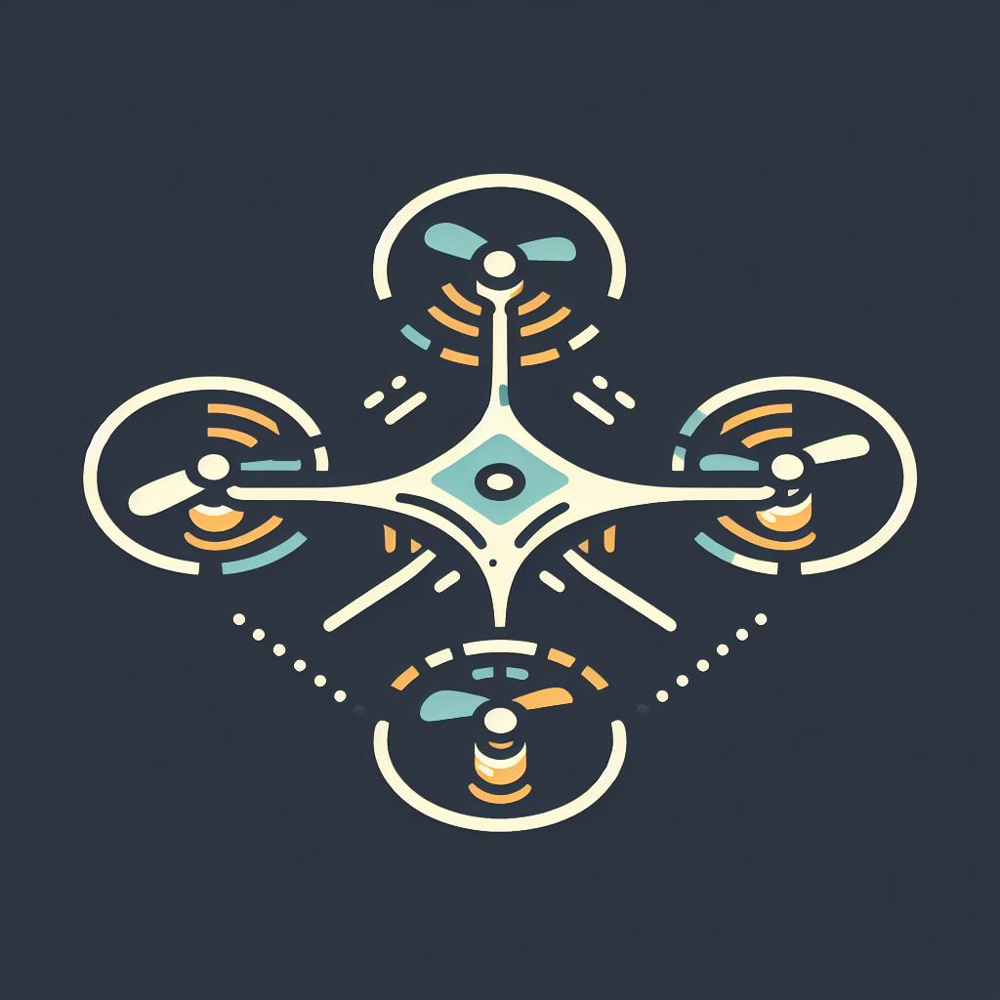
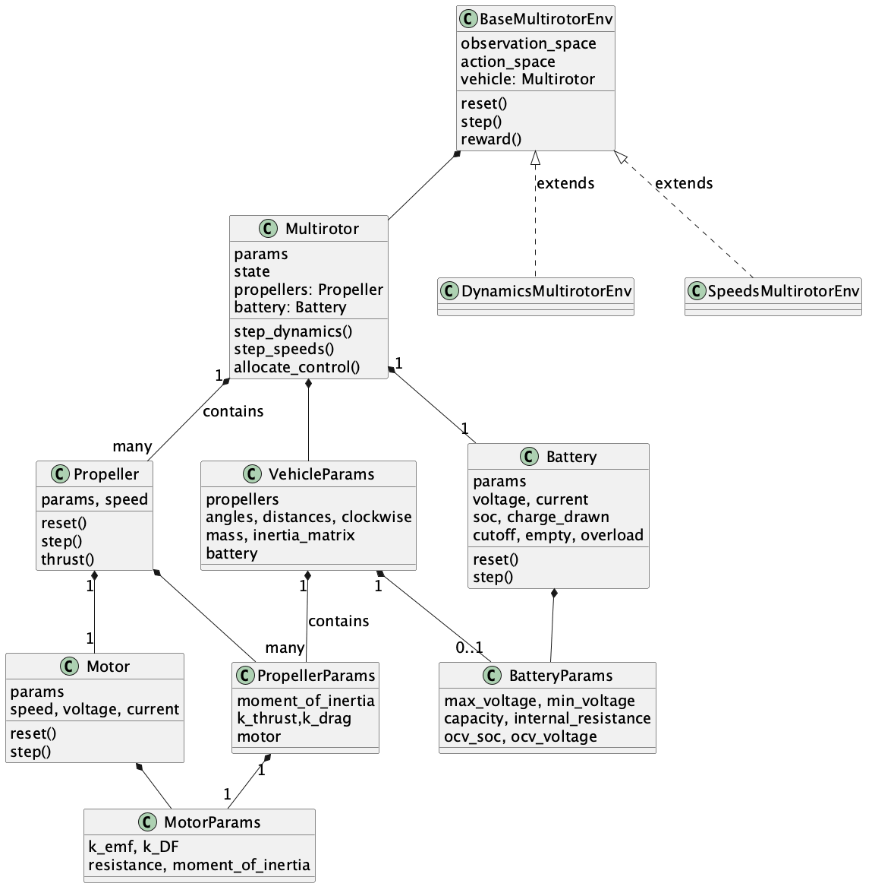
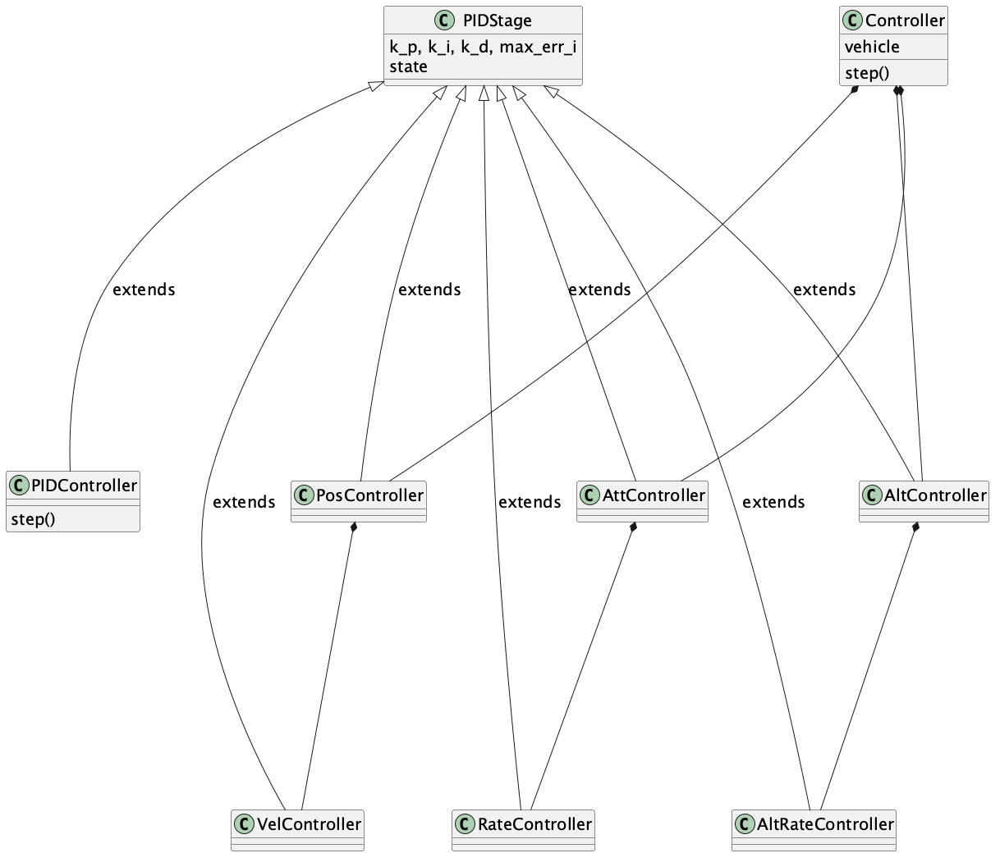

# multirotor

[](https://multirotor.readthedocs.io/en/latest/?badge=latest)



Simulation of multi-rotor unmanned aerial vehicles in python.

`multirotor` simulates the airframe, propellers, motors and battery of a UAV. It
includes a PID flight controller with automatic gain search, waypoint
trajectories, and [Gymnasium](https://gymnasium.farama.org) environments for
reinforcement learning. The physics runs in compiled [numba](https://numba.pydata.org)
kernels, so a simulation step takes microseconds.

## What you can do with it

**Create a vehicle** in the way that fits the data you have:

- From simple geometry: `helpers.vehicle_params_factory` builds `n` evenly spaced propellers around a body.
- From measured values: `vehicle.VehicleParams` takes any propeller layout, inertia matrix, `PropellerParams`, `MotorParams` and `BatteryParams`.
- From a ready-made model: `models.tarott18` (an octorotor) and `models.djimavicpro`.
- From components: `Propeller`, `Motor` and `Battery` can be simulated on their own.
- `helpers.learn_thrust_coefficient` and `helpers.learn_speed_voltage_scaling` fit coefficients to measurements.

**Simulate** at the level of detail you need:

- Step with forces and torques (`Multirotor.step_dynamics`) or with propeller speeds or voltages (`Multirotor.step_speeds`).
- Choose a quadratic thrust model, or a blade-element model in which thrust depends on airspeed.
- Add motors with electrical dynamics, and a battery whose voltage sags with the current drawn and cuts off when empty.
- Apply disturbance forces and torques, such as wind.
- Follow waypoints with `trajectories.Trajectory`, record with `helpers.DataLog`, and view with `visualize`.

**Control and tune.** `controller.Controller` is a cascaded PID controller for position, velocity, attitude and rate. `optimize.optimize` searches its gains with [optuna](https://optuna.org). Each trial flies the same set of start positions, and the best gains are scored on positions that the search did not fly.

**Train agents.** `env.DynamicsMultirotorEnv` takes forces and torques as actions, and `env.SpeedsMultirotorEnv` takes propeller speeds. Both follow the Gymnasium API. Subclass `env.BaseMultirotorEnv` to change the reward.

**Run fast.** One `step_speeds` call takes 12 µs for an 8-propeller vehicle, against 191 µs in the release before 0.6. With motors it takes 27 µs against 853 µs. A closed loop of controller and vehicle takes 20 µs per step against 125 µs. See `scripts/benchmarks` to reproduce the numbers.

## Example

Create a vehicle, tune a controller for it, and fly a path while logging:

```python
import matplotlib.pyplot as plt
from multirotor.vehicle import PropellerParams, SimulationParams
from multirotor.helpers import vehicle_params_factory, DataLog
from multirotor.simulation import Multirotor
from multirotor.optimize import optimize, get_controller, apply_params
from multirotor.trajectories import Trajectory
from multirotor.visualize import plot_datalog

# 1. A quadrotor from simple geometry
propeller = PropellerParams(k_thrust=0.01, k_drag=1e-2, moment_of_inertia=1e-3)
sim = SimulationParams(dt=0.01)                  # time step in seconds
params = vehicle_params_factory(
    n=4, m_prop=0.01, d_prop=0.3, params=propeller, m_body=2)
vehicle = Multirotor(params, sim)

# 2. Search for controller gains that fly this vehicle to the origin (~1 min)
study = optimize(params, sim, ntrials=100)
ctrl = get_controller(vehicle)
apply_params(ctrl, study.best_params)

# 3. Fly through three waypoints and log the flight
log = DataLog(vehicle, ctrl)
trajectory = Trajectory(
    vehicle, points=[[5, 0, 5], [5, 5, 5], [0, 0, 2]], proximity=0.5, resolution=1)
for step, (position, feed_forward_velocity) in enumerate(trajectory):
    dynamics = ctrl.step(reference=[*position, 0], feed_forward_velocity=feed_forward_velocity)
    speeds = vehicle.allocate_control(dynamics[0], dynamics[1:4])
    vehicle.step_speeds(speeds)
    log.log()
    if step == 6000:                             # stop if a waypoint is not reached
        break
log.done_logging()
plot_datalog(log, figsize=(8, 6))
plt.show()
```

The [Quickstart](https://multirotor.readthedocs.io/en/latest/Quickstart.html)
extends this example with motors and a battery, longer trajectories, and the
Gymnasium environments. The [Detailed Demo](https://multirotor.readthedocs.io/en/latest/Detailed%20Demo.html)
covers each component and the controller structure.

Code repository: [Github](https://github.com/hazrmard/multirotor)

Please cite this as:

```
@inproceedings{ahmed2022multirotor,
    title={A high-Fidelity Simulation test-Bed for fault-Tolerant octo-Rotor Control Using Reinforcement Learning},
    author={Ahmed, Ibrahim and Quinones-Grueiro, Marcos and Biswas, Gautam},
    booktitle={2022 IEEE/AIAA 41st Digital Avionics Systems Conference (DASC)},
    year={2022},
    organization={IEEE}
}
```

## Installation

Install from the Python Package Index (PyPI):

```bash
pip install multirotor
```

Or, clone repository and install for development. This will allow you to change the code of the package so the changes show up when you `import multirotor` in other projects.

```bash
git clone https://github.com/hazrmard/multirotor.git
cd multirotor
uv sync                  # creates .venv, installs package (editable) + dev group
uv sync --group docs     # also install documentation dependencies (used by Read the Docs)
uv sync --extra control  # optional `control` extra
```

Build and publish with [uv](https://docs.astral.sh/uv/):

```bash
uv build                 # writes sdist and wheel to dist/
uv publish               # uploads dist/* to PyPI (set UV_PUBLISH_TOKEN)
```

## Code organization

The following main classes are available in the code. For simulating the vehicle:


And for simulating control:


These diagrams show the classes a user works with. For developers, the module
docstrings of `multirotor/physics.py` and `multirotor/dynamics.py` show which
functions call which, and how the integrated state is laid out. Those of
`multirotor/controller/pid.py` and `multirotor/controller/kernels.py` do the same
for the controller. The compiled reward of the environments is in
`multirotor/env_kernels.py`.