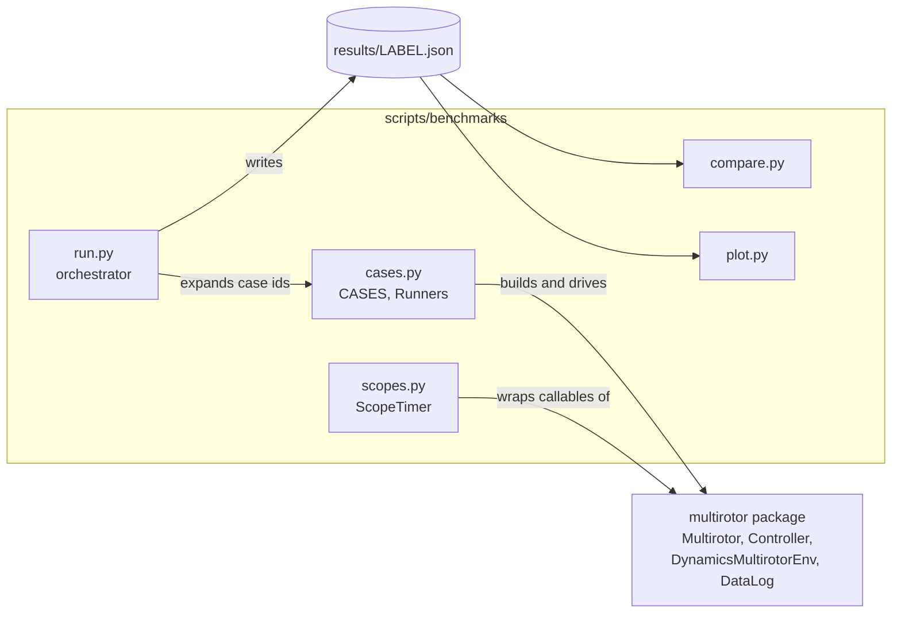
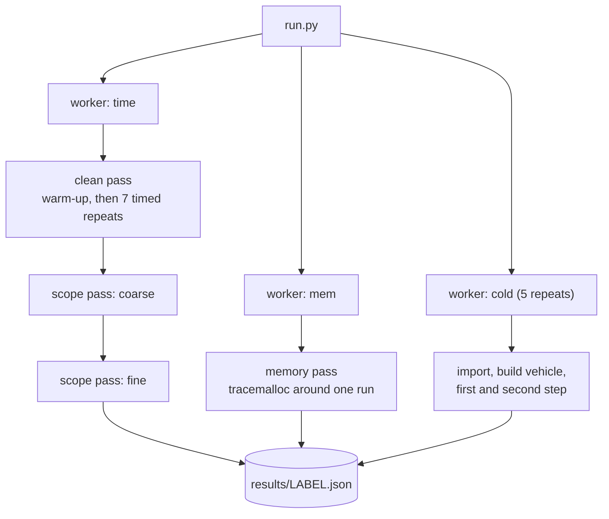
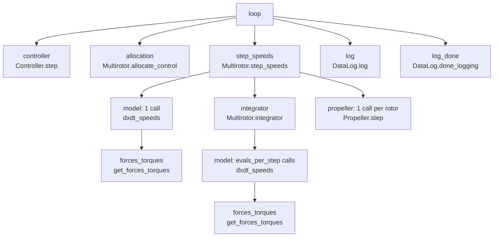

# Benchmarks

Speed and memory benchmarks for the `multirotor` simulator.

The scripts live outside the `multirotor/` package. The wheel ships only
`multirotor/`. The scripts import the installed package, as numpy and scipy do with
their `benchmarks/` directories.

## Quick reference

Components and data flow:



Passes run by `run.py` for each case id. Each worker is a fresh subprocess:



Scope tree of `closed_loop` (fine level):



## Usage

```
uv sync
uv run python scripts/benchmarks/run.py --label baseline     # full run, about 7 minutes on the dev VM
uv run python scripts/benchmarks/run.py --quick              # smoke test, not a measurement
uv run python scripts/benchmarks/run.py --list               # list case ids
# change code
uv run python scripts/benchmarks/run.py --label candidate
uv run python scripts/benchmarks/compare.py scripts/benchmarks/results/baseline.json scripts/benchmarks/results/candidate.json
uv run python scripts/benchmarks/plot.py scripts/benchmarks/results/baseline.json scripts/benchmarks/results/candidate.json --out charts
```

`run.py` writes `scripts/benchmarks/results/LABEL.json` (git-ignored). The label
defaults to a timestamp.

| command | option | effect |
|---|---|---|
| `run.py` | `--cases NAME ...` | run only these cases |
| | `--repeats N` | timed repeats per case (default 7) |
| | `--quick` | 3 repeats, fewer steps, no `log_scaling`, 3 cold-start repeats |
| | `--no-memory` | skip the memory pass |
| | `--scopes off\|coarse\|fine\|both` | scope passes to run (default `both`) |
| | `--tree` | print the scope tree of each case |
| `compare.py` | `--threshold PCT` | time regression limit (default 15) |
| | `--mem-threshold PCT` | `tracemalloc` peak regression limit (default 10) |
| | `--detail` | compare fine scopes instead of coarse |
| `plot.py` | `--out DIR`, `--theme light\|dark` | output directory, theme (at most 4 files) |

`compare.py` exits with status 1 when a case's median time grows by more than
`--threshold` percent. It also exits with 1 when a case's `tracemalloc` peak grows by
more than `--mem-threshold` percent. Cases with a baseline peak under 100 KiB are
exempt from the memory check. The scope deltas are diagnostic and do not affect the
exit status.

`plot.py` writes `time_per_step.png`, `speedup.png` (two or more files),
`breakdown.png`, `memory.png` and `log_scaling.png`.

## Cases

A case is a named benchmark with a list of parameter sets. A case id has the form
`name[param=value,...]`. `steps` appears in the id only for `log_scaling`.

| case | parameter sets | steps | `run(n)` calls |
|---|---|---|---|
| `step_speeds` | 4, 6, 8 rotors, constant thrust, excited; 8 rotors with motor model, excited; 8 rotors with blade-element thrust, excited; 8 rotors, constant thrust, hover | 1000 (blade: 300) | `Multirotor.step_speeds` |
| `step_dynamics` | 8 rotors, excited and hover | 1000 | `Multirotor.step_dynamics` |
| `controller_step` | 8 rotors | 5000 | `Controller.step` with a fixed vehicle state |
| `closed_loop` | 8 rotors, with and without `DataLog` | 2000 | `Controller.step`, `allocate_control`, `step_speeds` (and `DataLog.log`) |
| `run_sim` | 8 rotors | 1000 | `optimize.run_sim` through `DynamicsMultirotorEnv(allocate=True)`, which calls `step_dynamics` |
| `log_scaling` | 8 rotors, `DataLog` | 1000, 5000, 20000 | memory pass only |
| `cold_start` | none | none | fresh process: import, build vehicle, first and second `step_speeds` |

Common settings:

* `models.tarott18` propeller and motor constants, `dt=0.01`, `float32`.
* Vehicles come from `vehicle_params_factory` (0.5 kg per propeller, 4 kg body,
  0.635 m arms).
* The blade-element model uses an 18 in diameter, 6 in pitch propeller.
* Reference for controlled cases: hold 5 m altitude.

Input types:

* `excite=True`: cycles through 64 seeded vectors, each step selecting the next.
  `step_speeds` speeds vary by ±5% around hover. `step_dynamics` z-force varies by ±5%
  and torques by ±0.05 N·m.
* `excite=False`: constant hover input.

### Runner interface

Each case maps to a `Runner` class in `cases.py`.

| member | role |
|---|---|
| `reset()` | restores the initial state; not timed |
| `run(n)` | advances the simulation by `n` steps; timed |
| `dt` | simulated seconds per step, for `real_time_factor` |
| `scope_points()` | lists the callables to time as scopes |

To add a case, write a `Runner` in `cases.py` and add its parameter sets to `CASES`.

## Metrics

Terms:

* **step**: one simulation step of `dt` seconds.
* **model evaluation**: one call of `dxdt_speeds` or `dxdt_dynamics`.

Fields:

| field | definition |
|---|---|
| `us_per_step` | wall time per step in µs, one sample per repeat |
| `stats` | `min`, `median`, `mean`, `max`, `iqr`, `n` of `us_per_step`; comparisons use `median` |
| `real_time_factor` | simulated seconds per wall second, from `median` |
| `evals_per_step` | model evaluations requested by the integrator per step |
| `warmup_s`, `build_s` | warm-up and construction time in seconds |
| `peak_rss_mb` | peak RSS of the time worker process, including interpreter and libraries |
| `scopes` | scope trees, see below |
| `tracemalloc` | `peak_kb`, `net_kb`, `peak_bytes_per_step`, `net_bytes_per_step` |

Notes on `tracemalloc`:

* `peak_kb` is the high-water mark during one run.
* `net_kb` is the memory still held at the end of the run.
* `net_bytes_per_step` is meaningful for logging cases only. For other cases it is a
  small constant divided by the step count.

`evals_per_step` values from the baseline run on the dev VM: 4.0 at hover. 10.7 to
22.2 with excited inputs (`step_speeds`, `step_dynamics`).

## Scope tree

`scopes.py` records a tree of timed scopes. A scope is a callable wrapped by
`ScopeTimer.wrap`. Each scope has a path, such as
`loop/step_speeds/integrator/model`. The same callable under different parents has
different paths.

Per scope and step, the tree stores `calls_per_step`, `incl_us` and `excl_us`.

| quantity | definition |
|---|---|
| inclusive | time from scope entry to exit, children included |
| exclusive | inclusive time minus the inclusive time of its children |

Invariants, exact by construction:

* `inclusive(parent) = exclusive(parent) + sum(inclusive(child))`
* `sum(exclusive of all scopes) = inclusive(loop)`

Time that no child scope covers stays in the parent's exclusive time.

### Levels

| level | scopes |
|---|---|
| `coarse` | `controller`, `allocation`, `env.step`, `reward`, `step_speeds`, `step_dynamics`, `log`, `log_done` |
| `fine` | `coarse` plus `integrator`, `model`, `forces_torques`, `propeller` |

Each level runs as its own pass, so coarse timings carry no fine-scope wrapper cost.
Each case declares its scopes in `Runner.scope_points()`.

### Scope definitions

| scope | wrapped callable | covers |
|---|---|---|
| `loop` | `Runner.run` | the whole timed loop |
| `controller` | `Controller.step` | |
| `allocation` | `Multirotor.allocate_control` | |
| `env.step` | `DynamicsMultirotorEnv.step` | |
| `reward` | `DynamicsMultirotorEnv.reward` | |
| `step_speeds`, `step_dynamics` | `Multirotor.step_speeds`, `Multirotor.step_dynamics` | |
| `integrator` | `Multirotor.integrator` | one solver call |
| `model` | `Multirotor.dxdt_speeds`, `Multirotor.dxdt_dynamics` | one model evaluation |
| `forces_torques` | `Multirotor.get_forces_torques` | per-rotor forces and torques |
| `propeller` | `Propeller.step` | one rotor |
| `log`, `log_done` | `DataLog.log`, `DataLog.done_logging` | |

Within `step_speeds` and `step_dynamics`, the model has two paths:

* `step/model`: the one evaluation that stores `_dxdt` before the solve.
* `step/integrator/model`: the evaluations the integrator requests.
  `evals_per_step` is their count per integrator call.

Remaining details:

* `integrator` exclusive time is solver overhead: LSODA bookkeeping plus the call
  into Python.
* `model` exclusive time is the jitted kernel plus rounding. `forces_torques` is a
  child of `model`.
* Jitted functions (`apply_forces_torques`, `torque`) cannot be wrapped. Their time
  stays in the exclusive time of the calling scope.
* `Multirotor.integrator` exists since the injectable-integrator change. Callables
  that do not exist on a commit are skipped. The scope is then absent.

### Mapping to simulation components

| component | tree quantity |
|---|---|
| model evaluation | `model` inclusive |
| integrator | `integrator` exclusive |
| one `step_*()` call | `step_speeds` or `step_dynamics` inclusive |
| controller | `controller` inclusive |
| env step | `env.step` inclusive minus `step_dynamics` inclusive |
| full simulation step | `loop` inclusive |

### Overhead and validity

* Each wrapper adds about 0.8 µs per call. `scopes.calibrate()` measures two constants
  (`a_ns`, `b_ns`, stored in the result file). `ScopeTimer.report()` subtracts them.
* The scope pass runs the same number of steps as the clean pass, with GC disabled.
* `vs_clean` is the scope tree's `total_us` divided by the clean pass's median.
  `run.py` prints a warning when it exceeds 1.3.
* `python scripts/benchmarks/scopes.py` self-tests the invariants.

## Method

* Each measurement runs in its own subprocess: `time`, `mem` and `cold` workers.
* The clean pass runs `min(50, steps)` warm-up steps, then the timed repeats. Warm-up
  absorbs numba compilation. `warmup_s` and `cold_start` report it.
* Timed repeats call `reset()`, then time `run(steps)` with `perf_counter_ns` and GC
  disabled.
* The memory pass runs after a warm-up, with `tracemalloc` active around one run.
* Each result file records the git SHA, a dirty flag, the CPU model, and the Python,
  numpy, scipy and numba versions.
* `compare.py` warns when the CPUs differ and when either file comes from `--quick`.

Noise:

* Two full runs of one commit on the dev VM differed by up to 11% per case. Short
  cases and the blade-element case varied most.
* The default `--threshold` of 15% exceeds that spread.
* `evals_per_step` is deterministic.
* Run on an idle machine. Optionally pin the process (`taskset -c 0`). Compare only
  files from the same host.
