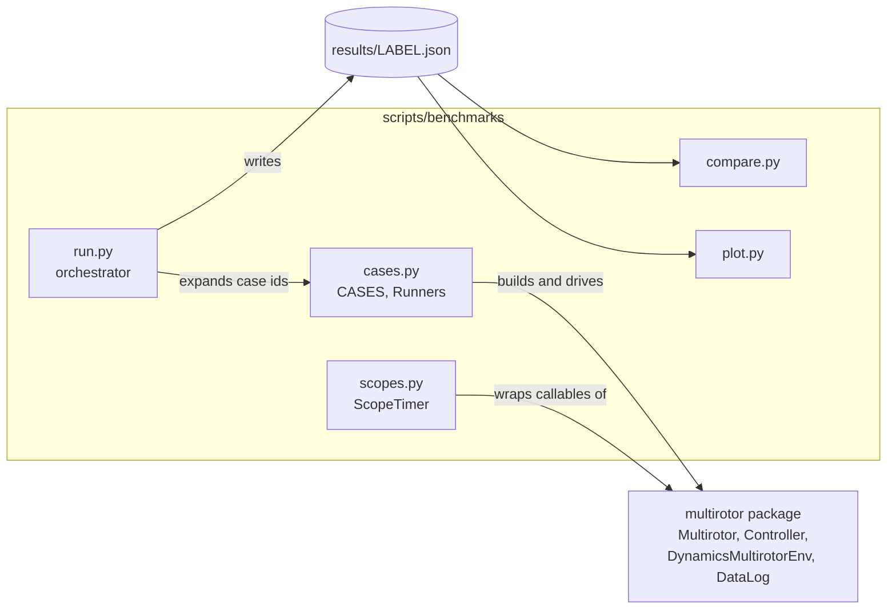
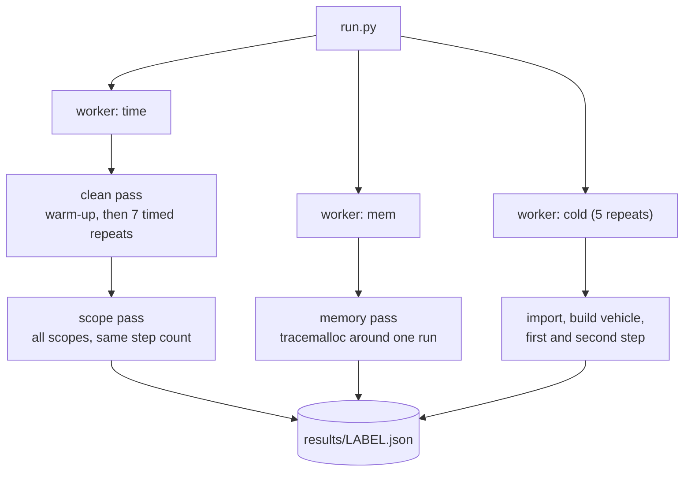
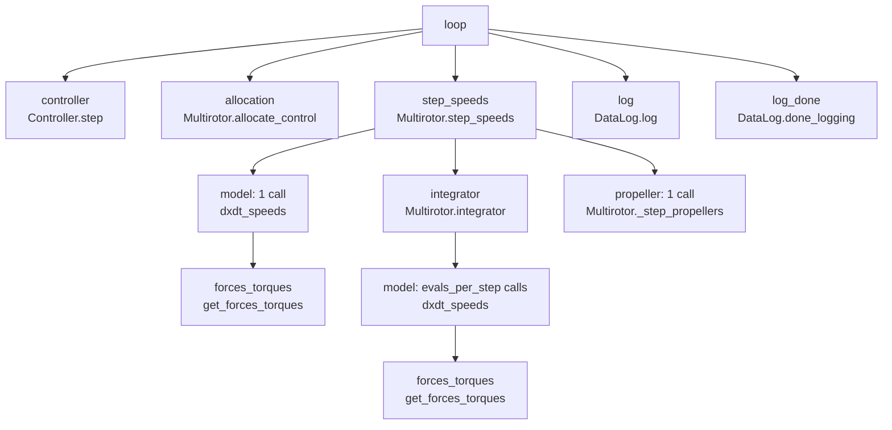
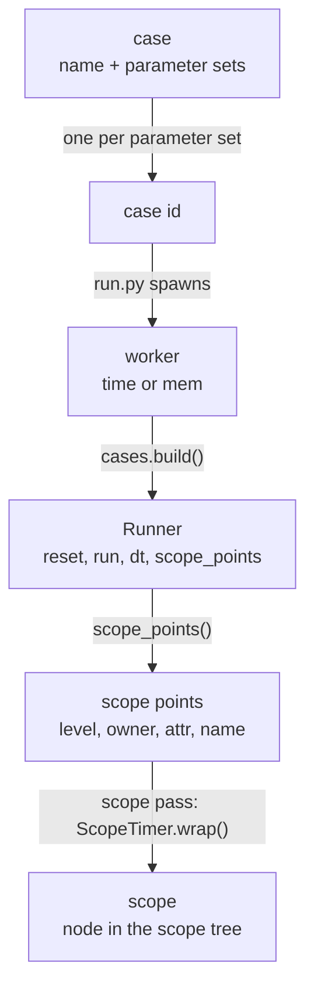

# Benchmarks

Speed and memory benchmarks for the `multirotor` simulator.

The scripts live outside the `multirotor/` package. The wheel ships only
`multirotor/`. The scripts import the installed package, as numpy and scipy do with
their `benchmarks/` directories.

## Quick reference

Components and data flow:



Passes run by `run.py` for each case id. Each worker is a fresh subprocess:



Scope tree of `closed_loop` (all scopes):



## Concepts

| term | definition | created by |
|---|---|---|
| case | named benchmark, such as `step_speeds`: a Runner class, parameter sets and how to measure them | `Case` entries in `CASES` (`cases.py`) |
| case id | one case with one parameter set, such as `step_speeds[n=8,...]` | `cases.expand()` |
| Runner | object that drives the simulation for one case id | `cases.build(name, params)` |
| scope point | `ScopePoint(level, owner, attr, name)`: a callable that a Runner offers for timing | `Runner.scope_points()` |
| scope | a scope point wrapped by `ScopeTimer` during the scope pass; a node in the scope tree | `ScopeTimer.wrap()` |
| worker | subprocess that runs `run.py` for one case id and one kind of pass | `run.py` `spawn()` |
| pass | one measurement inside a worker: clean, scope or memory | worker functions in `run.py` |

Relationships:

* A case has one or more case ids, one per parameter set.
* For each case id, `run.py` starts the workers named in the case's `measures`: `time`
  and `mem` by default. `log_scaling` has `measures=('mem',)`. The `cold` worker belongs
  to no case id.
* Each worker builds its own Runner for its case id.
* A Runner lists its scope points. Only the scope pass uses them. The scope pass wraps
  each scope point's callable. Each wrapped callable becomes a scope at a path in the
  tree.



## Usage

```
uv sync
uv run python scripts/benchmarks/run.py --label baseline     # full run, several minutes
uv run python scripts/benchmarks/run.py --quick              # smoke test, not a measurement
uv run python scripts/benchmarks/run.py --list-cases         # list case ids
# change code
uv run python scripts/benchmarks/run.py --label candidate
uv run python scripts/benchmarks/compare.py scripts/benchmarks/results/baseline.json scripts/benchmarks/results/candidate.json
uv run python scripts/benchmarks/plot.py scripts/benchmarks/results/baseline.json scripts/benchmarks/results/candidate.json --out charts
```

`run.py` writes `scripts/benchmarks/results/LABEL.json` (git-ignored). The label
defaults to a timestamp.

| command | option | effect |
|---|---|---|
| `run.py` | `--cases NAME ...` | run only these cases |
| | `--repeats N` | timed repeats per case (default 7) |
| | `--quick` | 3 repeats, each case's `quick_steps`, cases without `quick_steps` skipped, 3 cold-start repeats |
| | `--no-memory` | skip the memory pass |
| | `--list-cases` | print case ids and exit |
| | `--no-scopes` | skip the scope pass |
| | `--tree` | print the scope tree of each case |
| `compare.py` | `--threshold PCT` | time regression limit (default 15) |
| | `--mem-threshold PCT` | `tracemalloc` peak regression limit (default 10) |
| | `--detail` | compare all scopes instead of the coarse view |
| `plot.py` | `--out DIR`, `--theme light\|dark` | output directory, theme (at most 4 files) |

`compare.py` exits with status 1 when a case's median time grows by more than
`--threshold` percent. It also exits with 1 when a case's `tracemalloc` peak grows by
more than `--mem-threshold` percent. Cases with a baseline peak under 100 KiB are
exempt from the memory check. The scope deltas are diagnostic and do not affect the
exit status.

`plot.py` writes `time_per_step.png`, `speedup.png` (two or more files),
`breakdown.png`, `memory.png` and one `CASE.png` per sweep case (`log_scaling.png`).

## Cases

A case is a named benchmark with a list of parameter sets. A case id has the form
`name[param=value,...]`. `steps` appears in the id only when it is the case's sweep
parameter (`log_scaling`).

| case | parameter sets | steps | `run(n)` calls |
|---|---|---|---|
| `step_speeds` | 4, 6, 8 rotors, `thrust_model='quadratic'`, excited; 8 rotors with motor model, excited; 8 rotors, `thrust_model='fsolve'`, excited with `excite_frac=0.002`; 8 rotors, `thrust_model='quadratic'`, hover | 1000 (`fsolve`: 128) | `Multirotor.step_speeds` |
| `step_dynamics` | 8 rotors, excited and hover | 1000 | `Multirotor.step_dynamics` |
| `controller_step` | 8 rotors | 5000 | `Controller.step` with a fixed vehicle state |
| `closed_loop` | 8 rotors, with and without `DataLog` | 2000 | `Controller.step`, `allocate_control`, `step_speeds` (and `DataLog.log`) |
| `run_sim` | 8 rotors | 1000 | `optimize.run_sim` through `DynamicsMultirotorEnv(allocate=True)`, which calls `step_dynamics` |
| `log_scaling` | 8 rotors, `DataLog` | 1000, 5000, 20000 | memory pass only |
| `cold_start` | none | none | fresh process: import, build vehicle, first and second `step_speeds` |

Common settings:

* `models.tarott18` propeller and motor constants, `dt=0.01`, `float32`.
* Vehicles come from `vehicle_params_factory` (0.5 kg per propeller, 4 kg body,
  0.635 m arms).
* `thrust_model='quadratic'`: thrust = `k_thrust * speed**2`
  (`PropellerParams.use_thrust_constant=True`).
* `thrust_model='fsolve'`: blade-element model (`use_thrust_constant=False`). For each
  propeller and model evaluation, `physics.thrust` solves for the induced velocity
  with `scipy.optimize.fsolve`. The propeller has an 18 in diameter and 6 in pitch.
* Reference for controlled cases: hold 5 m altitude.

Input types:

* `excite=True`: cycles through 64 seeded input vectors, each step selecting the next.
  `step_speeds` speeds vary by up to ±`excite_frac` around hover (default 5%).
  `step_dynamics` z-force varies by ±5% and torques by ±0.05 N·m.
* `excite=False`: constant hover input.

Hover and restarts:

* `cases.nominal_speed()` solves for the propeller speed at which one rotor carries
  its share of the weight (`helpers.find_nominal_speed` on the propeller's own thrust
  function). The solution differs per thrust model: for 8 rotors it is 315.7 rad/s for
  `'quadratic'` and 139.7 rad/s for `'fsolve'`.
* With a motor model, `cases.hover_speeds()` returns the signal that settles the motor
  at the nominal speed (`cases.motor_signal()`). `StepSpeeds.reset()` starts the
  propellers and motors at the nominal speed.
* At `excite=False`, the vehicle holds its initial state exactly for all variants.
* At `excite=True`, the inputs are open loop (no controller). `run()` calls `reset()`
  every 64 steps, so the vehicle restarts from hover at the start of each input cycle.
  The trajectory repeats, and cost per step does not depend on the step count (for
  64 steps or more). A restart costs about 34 µs for `step_speeds`, once per 64 steps.
* The `fsolve` case uses `excite_frac=0.002`. In a 64-step probe, perturbations of ±1%
  or more made `scipy.optimize.fsolve` fail to converge (thousands of
  `RuntimeWarning`s) and raised the cost per step from 5.5 ms to 23 to 30 ms.

### Runner interface

Each case maps to a `Runner` class in `cases.py`.

| member | role |
|---|---|
| `reset()` | restores the initial state; not timed |
| `run(n)` | advances the simulation by `n` steps; timed |
| `dt` | simulated seconds per step, for `real_time_factor` |
| `scope_points()` | returns the `ScopePoint`s a scope pass wraps |

### Case fields

`CASES` maps a case name to a `Case` dataclass.

| field | meaning |
|---|---|
| `runner` | `Runner` subclass built from each parameter set |
| `params` | parameter sets; each yields one case id. `steps` is the steps per run and is not passed to the Runner |
| `measures` | workers to start per case id: `'time'` and/or `'mem'` (default both) |
| `sweep` | parameter that the parameter sets sweep, such as `'steps'`; result records carry it and plots draw the case as a line over it (default none) |
| `quick_steps` | `steps` under `--quick`; `None` excludes the case from `--quick` |

To add a case, write a `Runner` in `cases.py` and add a `Case` to `CASES`.

## Metrics

Terms:

* **step**: one simulation step of `dt` seconds.
* **model evaluation**: one call of `dxdt_speeds` or `dxdt_dynamics`.

Fields:

| field | definition |
|---|---|
| `us_per_step` | wall time per step in µs, one sample per repeat |
| `stats` | `min`, `median`, `mean`, `max`, `iqr`, `n` of `us_per_step`; comparisons use `median` |
| `real_time_factor` | simulated seconds per wall second, from `median` |
| `evals_per_step` | model evaluations requested by the integrator per step |
| `warmup_s`, `build_s` | warm-up and construction time in seconds |
| `peak_rss_mb` | peak RSS of the time worker process, including interpreter and libraries |
| `scopes` | the scope tree, with `skipped` scope points and `vs_clean`; see Scope tree |
| `tracemalloc` | `peak_kb`, `net_kb`, `peak_bytes_per_step`, `net_bytes_per_step` |

Notes on `tracemalloc`:

* `peak_kb` is the high-water mark during one run.
* `net_kb` is the memory still held at the end of the run.
* `net_bytes_per_step` is meaningful for logging cases only. For other cases it is a
  small constant divided by the step count.

`evals_per_step` values from the baseline run on the dev VM: 4.0 at hover. 10.1 to
16.3 with excited inputs (`step_speeds`, `step_dynamics`).

## Scope tree

`scopes.py` records a tree of timed scopes. A scope is a callable wrapped by
`ScopeTimer.wrap`. Each scope has a path, such as
`loop/step_speeds/integrator/model`. The same callable under different parents has
different paths.

Per scope and step, the tree stores `calls_per_step`, `incl_us` and `excl_us`.

| quantity | definition |
|---|---|
| inclusive | time from scope entry to exit, children included |
| exclusive | inclusive time minus the inclusive time of its children |

Invariants, exact by construction:

* `inclusive(parent) = exclusive(parent) + sum(inclusive(child))`
* `sum(exclusive of all scopes) = inclusive(loop)`

Time that no child scope covers stays in the parent's exclusive time.

### Levels

`Level` in `scopes.py` is an `IntEnum`: `Level.COARSE = 0`, `Level.FINE = 1`. Each
scope point carries a level. The scope pass wraps every scope point and stores one
tree. Each item in the tree records its `level` (`'coarse'` or `'fine'`).

| level | scopes |
|---|---|
| `coarse` | `loop`, `controller`, `allocation`, `env.step`, `reward`, `step_speeds`, `step_dynamics`, `log`, `log_done` |
| `fine` | `integrator`, `model`, `forces_torques`, `propeller` |

`scopes.view(tree, Level.COARSE)` returns the coarse tree. It removes fine scopes from
paths and adds their time to the exclusive time of the nearest coarse ancestor:

* `exclusive'(p) = inclusive(p) - sum(inclusive(q))` over the nearest kept descendants
  `q` of `p`.
* The invariants above still hold.

`compare.py` shows the coarse view by default and the full tree with `--detail`.

### Scope points

Each Runner declares its scopes in `Runner.scope_points()`. A `ScopePoint` has four
fields:

| field | meaning |
|---|---|
| `level` | `Level.COARSE` or `Level.FINE`; the detail level of the scope, used by `view()` |
| `owner` | instance or class that holds the callable |
| `attr` | name of a callable attribute of `owner`; `owner.attr` must exist |
| `name` | scope name in the tree |

Example: the following point times `controller.step` as the scope `controller`.

```python
ScopePoint(Level.COARSE, controller, 'step', 'controller')
```

If `owner.attr` does not exist, the scope pass skips the point and lists `'Owner.attr'` under
`skipped` in the scope tree. `run.py` prints a warning for skipped scopes. This
happens, for example, for `Multirotor.integrator` on commits that predate it, and for
misspelled attribute names.

### Scope definitions

| scope | wrapped callable | covers |
|---|---|---|
| `loop` | `Runner.run` | the whole timed loop |
| `controller` | `Controller.step` | |
| `allocation` | `Multirotor.allocate_control` | |
| `env.step` | `DynamicsMultirotorEnv.step` | |
| `reward` | `DynamicsMultirotorEnv.reward` | |
| `step_speeds`, `step_dynamics` | `Multirotor.step_speeds`, `Multirotor.step_dynamics` | |
| `integrator` | `Multirotor.integrator` | one solver call |
| `model` | `Multirotor.dxdt_speeds`, `Multirotor.dxdt_dynamics` | one model evaluation |
| `forces_torques` | `Multirotor.get_forces_torques` | per-rotor forces and torques |
| `propeller` | `Multirotor._step_propellers` | all rotors, after integration |
| `log`, `log_done` | `DataLog.log`, `DataLog.done_logging` | |

Within `step_speeds` and `step_dynamics`, the model has two paths:

* `step/model`: the one evaluation that stores `_dxdt` before the solve.
* `step/integrator/model`: the evaluations the integrator requests.
  `evals_per_step` is their count per integrator call.

Remaining details:

* `integrator` exclusive time is solver overhead: LSODA bookkeeping plus the call
  into Python.
* `model` exclusive time is the jitted kernel plus rounding. `forces_torques` is a
  child of `model`.
* Jitted functions (`body_derivative`, `torque`) cannot be wrapped. Their time
  stays in the exclusive time of the calling scope.
* `Multirotor.integrator` exists since the injectable-integrator change. On earlier
  commits the point is skipped, the `integrator` scope is absent and `skipped` lists
  `Multirotor.integrator`.

### Mapping to simulation components

| component | tree quantity |
|---|---|
| model evaluation | `model` inclusive |
| integrator | `integrator` exclusive |
| one `step_*()` call | `step_speeds` or `step_dynamics` inclusive |
| controller | `controller` inclusive |
| env step | `env.step` inclusive minus `step_dynamics` inclusive |
| full simulation step | `loop` inclusive |

### Overhead and validity

* Each wrapper adds about 0.8 µs per call. `scopes.calibrate()` measures two constants
  (`a_ns`, `b_ns`, stored in the result file). `ScopeTimer.report()` subtracts them.
* The scope pass runs the same number of steps as the clean pass, with GC disabled.
* The scope pass records every scope at once, so its wrapper overhead is the fine
  level's. `vs_clean` measures the remaining error.
* `vs_clean` is the scope tree's `total_us` divided by the clean pass's median.
  `run.py` prints a warning when it exceeds 1.3.
* `python scripts/benchmarks/scopes.py` self-tests the invariants.

## Method

* Each measurement runs in its own subprocess: `time`, `mem` and `cold` workers.
* The clean pass runs `min(50, steps)` warm-up steps, then the timed repeats. Warm-up
  absorbs numba compilation. `warmup_s` and `cold_start` report it.
* Timed repeats call `reset()`, then time `run(steps)` with `perf_counter_ns` and GC
  disabled.
* The memory pass runs after a warm-up, with `tracemalloc` active around one run.
* Each result file records the git SHA, a dirty flag, the CPU model, and the Python,
  numpy, scipy and numba versions.
* `compare.py` warns when the CPUs differ and when either file comes from `--quick`.
* A worker that fails does not abort the run. `run.py` stores the error text under
  `error` in that case's record, continues, writes the result file, then exits with
  status 1. `compare.py` counts a case that fails in the candidate only as a regression.

Noise:

* Two full runs of one commit on the dev VM differed by up to 11% per case. Short
  cases and the `fsolve` thrust model case varied most.
* The default `--threshold` of 15% exceeds that spread.
* `evals_per_step` is deterministic for a fixed case id, step count and floating-point
  behavior.
* Run on an idle machine. Optionally pin the process (`taskset -c 0`). Compare only
  files from the same host.
